<picture>
  <source media="(prefers-color-scheme: dark)" srcset="assets/hero-dark.svg">
  
</picture>

### Sparsh Khanna

Software developer at Ericsson in Ottawa. Computer science at UBC Okanagan before that.

Outside work I build things that start with a dataset and a question. Lately that has meant satellite fire records, stock-market backtests and reading code repositories to see what they say about the person who wrote them.

### Things I've built

| Project | What it does | Built with |
|---|---|---|
| [One Burning Calendar](https://github.com/OM200401/SpaceApps-2026-Harmonization-MODIS-VIIRS) | NASA Space Apps 2026, team of four. Two satellite sensor families have logged fire hotspots since 2000, and their counts can't be compared directly. We merged them into one monthly calendar for any area you pick on a map. [Open the app](https://om200401.github.io/SpaceApps-2026-Harmonization-MODIS-VIIRS/app/) | Python, DuckDB, JavaScript |
| [Zip2Job](https://github.com/COSC-499-W2025/capstone-project-team-5) | UBC capstone. Upload your code repositories and it works out your skills and the role you played, then drafts the documents you'd send to an employer. | Python, JavaScript |
| Context Code | Research platform at UBC Okanagan, built with [Ojus Sharma](https://github.com/ojusharma). It writes coding problems themed around what a student cares about, to test whether that improves engagement. | TypeScript |
| [S&P 500 Strategy Analyzer](https://github.com/Sparshkhannaa/Analyser) | An LSTM forecasts the S&P 500 from 31 technical indicators, then backtests position-sizing strategies to find the best risk-adjusted one. | Python |

Earlier coursework: [Communicado](https://github.com/Sparshkhannaa/Communicado) (e-ticketing), [Klopp Kits](https://github.com/Sparshkhannaa/klopp-kits-), and an [analysis of IPL player performance](https://github.com/Sparshkhannaa/Evaluation-of-IPL-player-performance-).

### Right now

Learning embedded Linux.

### Languages I've written

  &nbsp;
  &nbsp;
  &nbsp;
  &nbsp;
  &nbsp;
  <picture><source media="(prefers-color-scheme: dark)" srcset="assets/icons/bash-dark.svg"></picture>&nbsp;
  &nbsp;
  &nbsp;
  

### Say hello

[LinkedIn](https://www.linkedin.com/in/sparshkhannaubc/)
